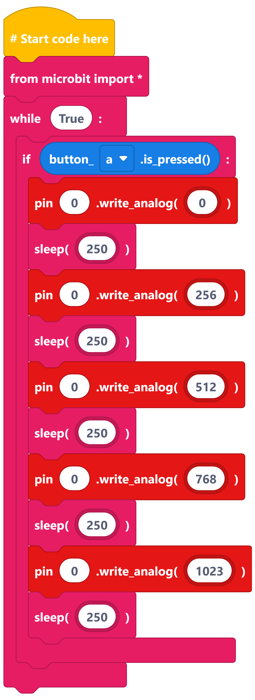
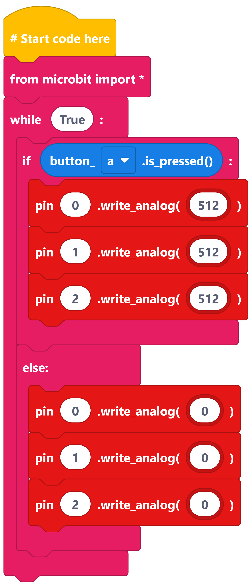
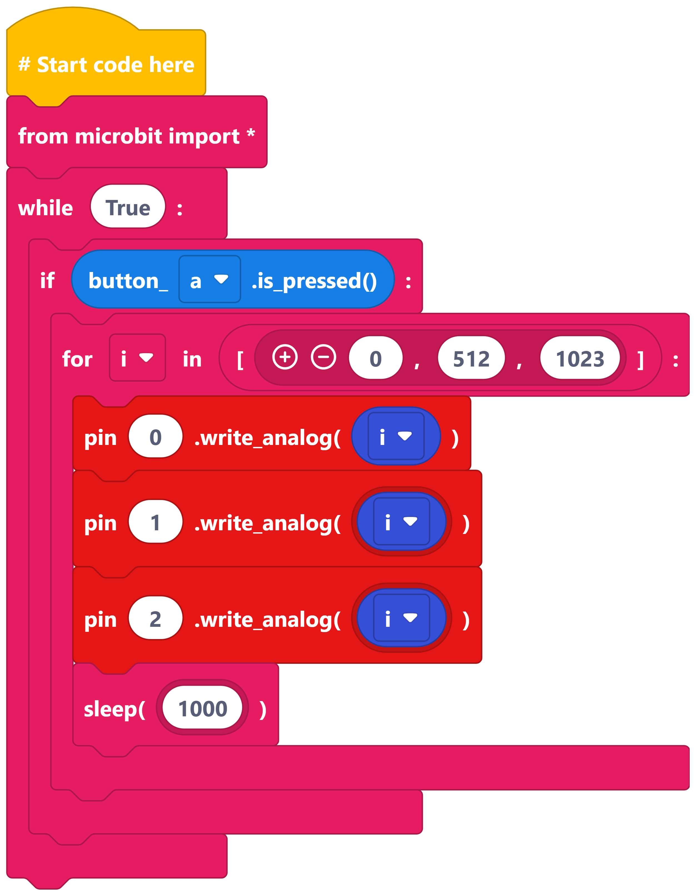

==========================
LED brightness
==========================

Write analog
----------------------------------------

| Use: ``write_analog()`` to control the **brightness** of an LED.
| The value in ``write_analog()`` can be from **0 to 1023**.

----

Changing red LED brightness
----------------------------------------

----

All half brightness
----------------------------------------

----

Using a list of brightness values
----------------------------------------

    .. image:: images_edublocks/LED_012_list_brightness_btnAB.png
    :scale: 25 %