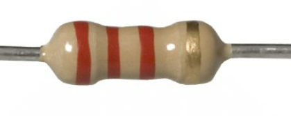
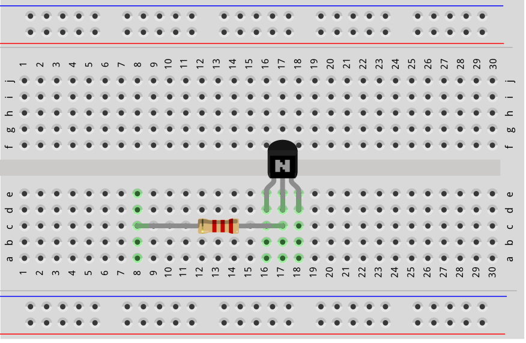
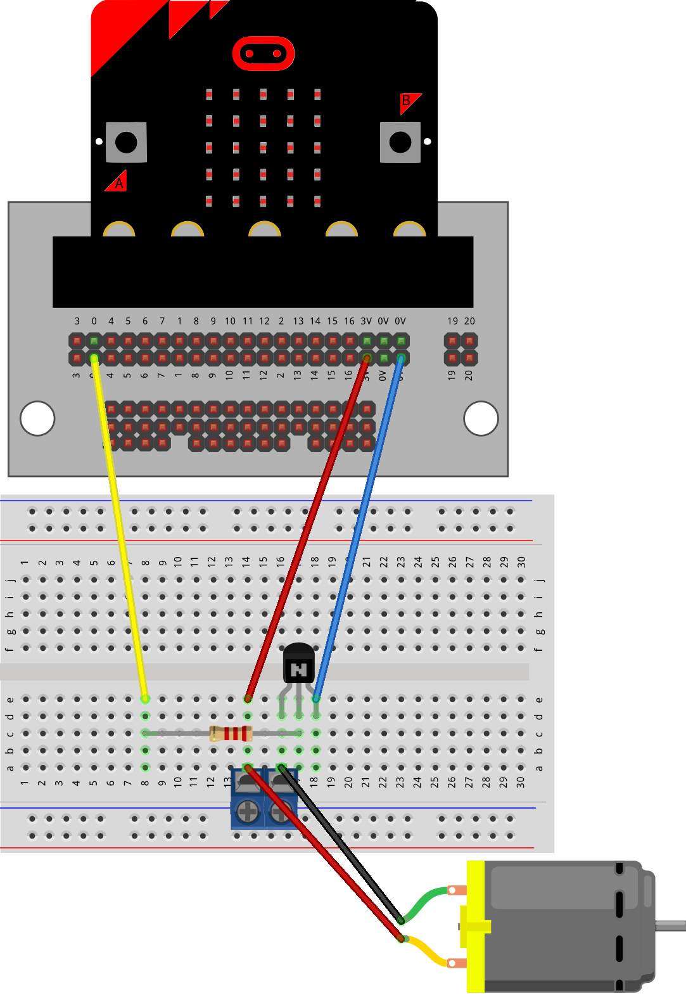
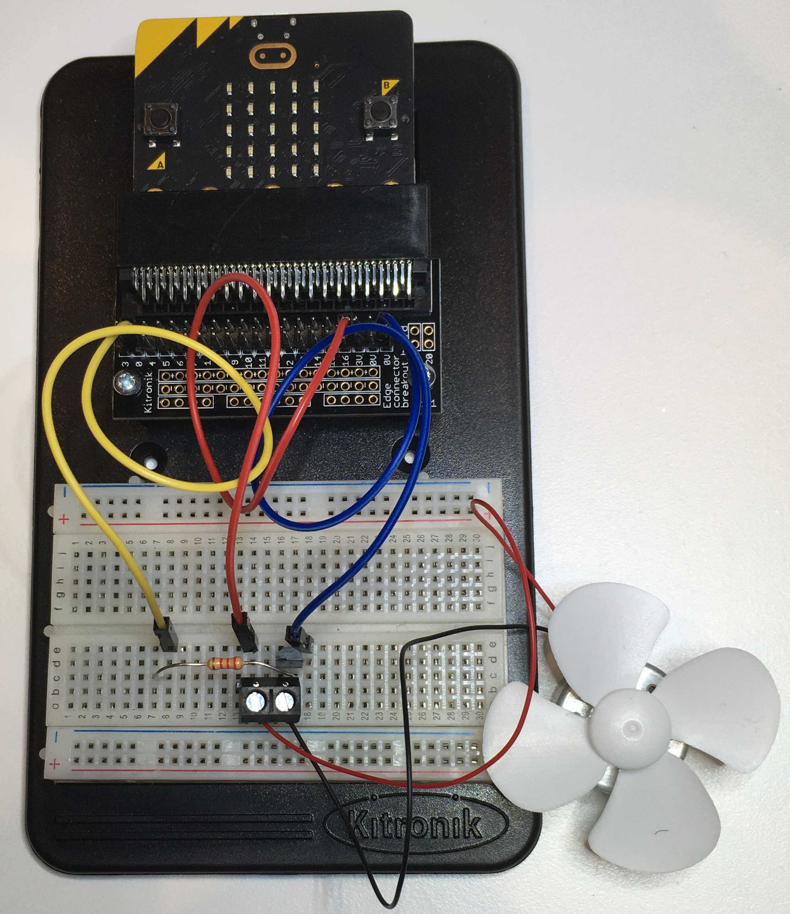
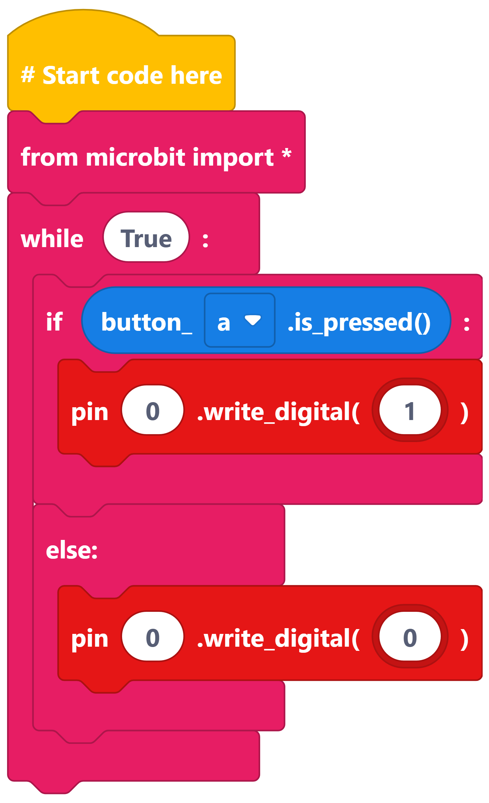
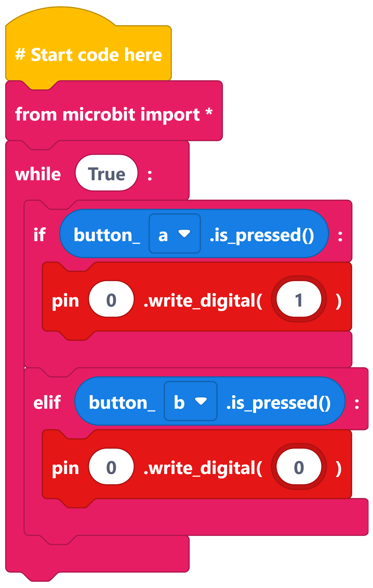

==========================
Motor_with_transistor_1
==========================

Making a Motor Move
=========================

* A **2.2 k ohm resistor** with colour bands: Red, Red, Red, Gold

----

Building the circuit
----------------------------------------

----

Control the Motor with Button A
----------------------------------------

----

Control the Motor with Buttons A and B
----------------------------------------

----

Motor timing challenges
----------------------------------------

.. image:: images_edublocks/Motor_btnAB_timimg.png
    :scale: 25 %

