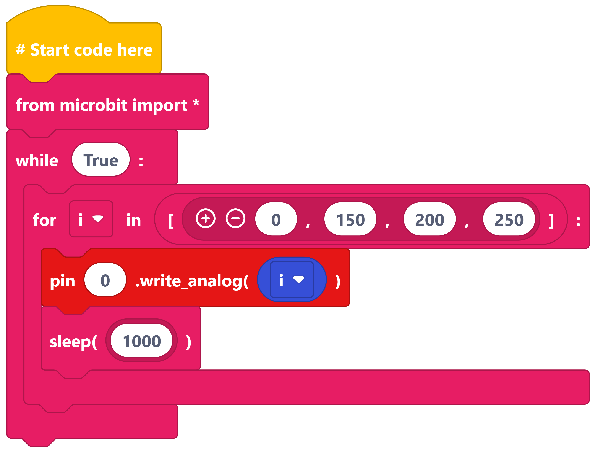
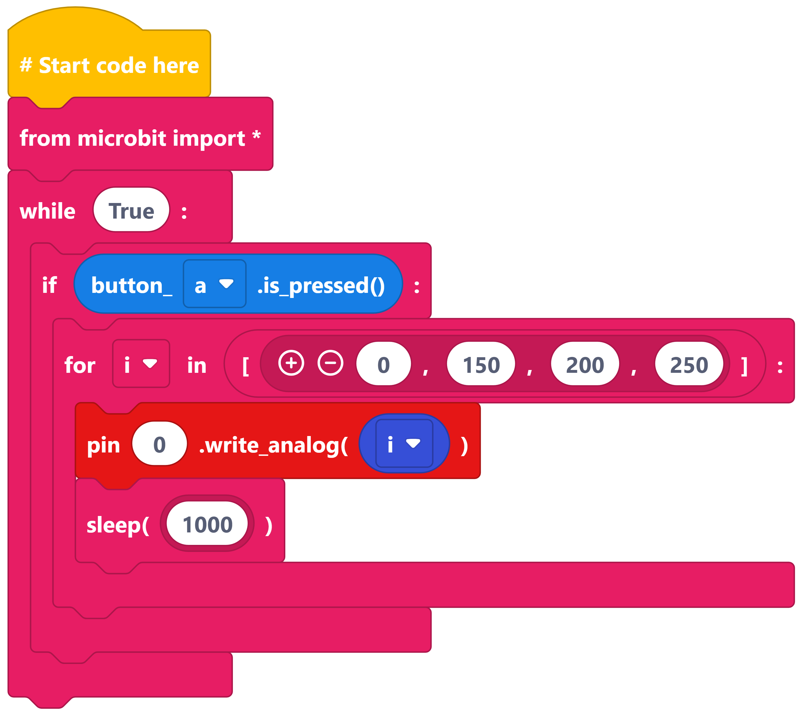

==========================
Motor_with_transistor_2
==========================

Write analog
----------------------------------------

| Use the ``write_analog(1023)`` command to turn the motor ON.
| Use the ``write_analog(0)`` command to turn the motor OFF.

| The value in ``write_analog()`` can be from **0 to 1023**.
| The bigger the number: **the faster the motor turns**

----

Changing motor speed with a list
----------------------------------------

----

Changing motor speed via button A
----------------------------------------

