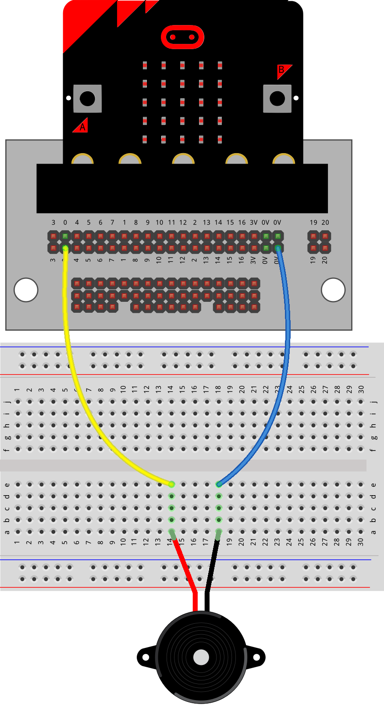
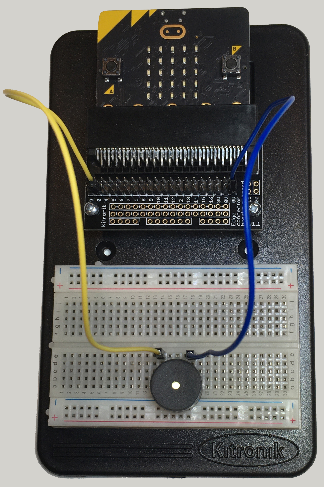
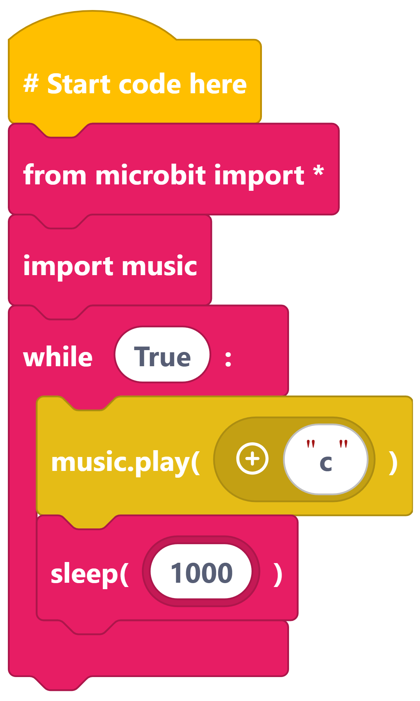
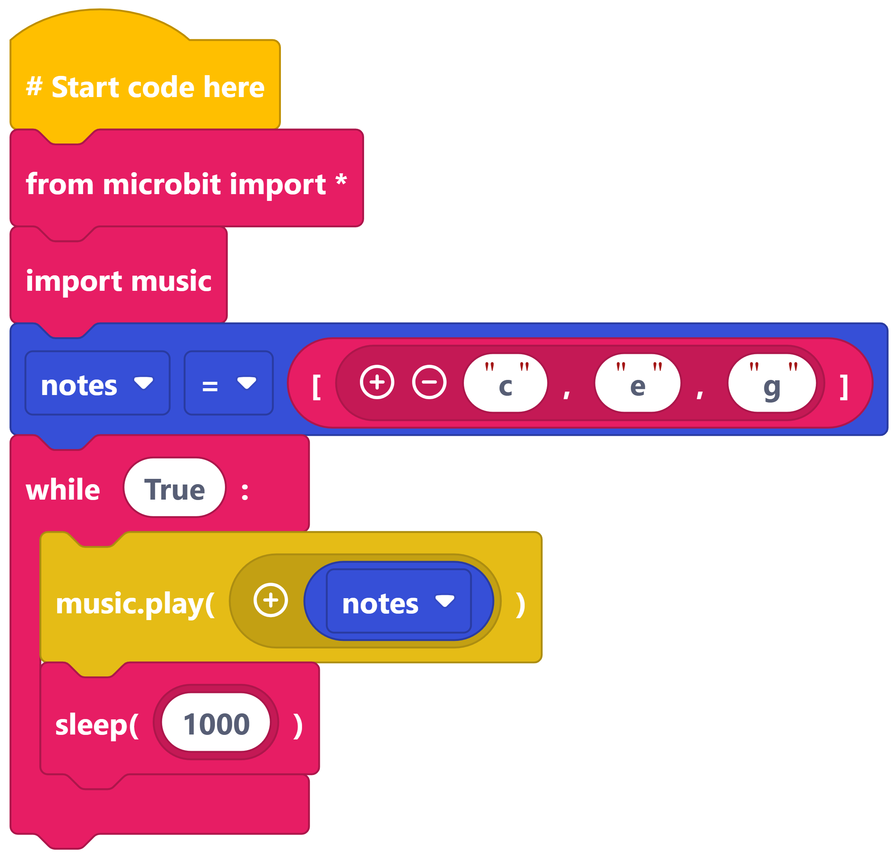
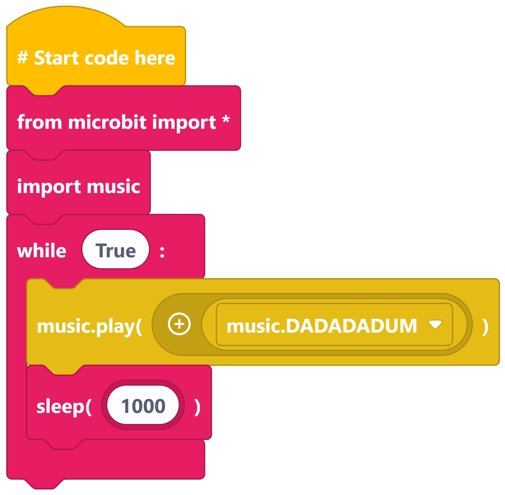
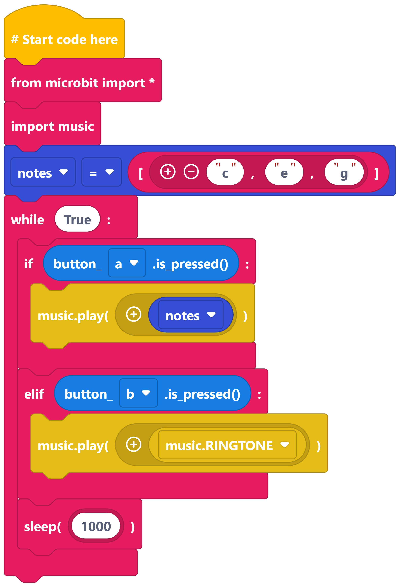

====================================
Piezo_Buzzer_1
====================================

Build the circuit
----------------------------------------

----

Play a note
----------------------------------------

| To play sounds we need the ``music`` library.

----

Play a note list
----------------------------------------

----

Play a built in melody
----------------------------------------

----

Button control
----------------------

