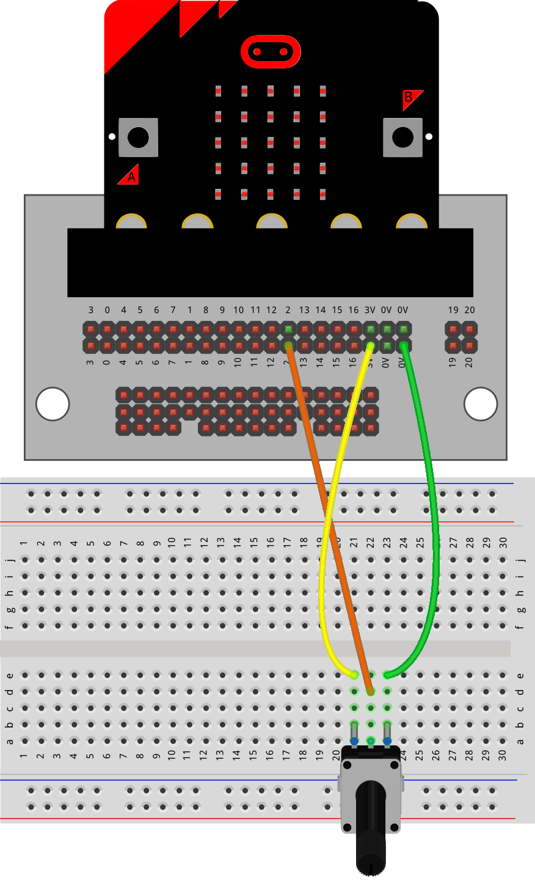
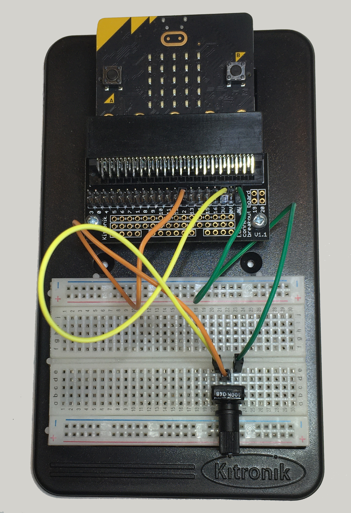
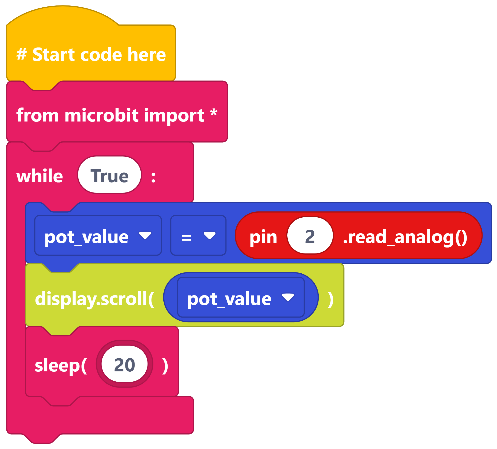

==========================
Potentiometer
==========================

Build the circuit
----------------------------------------

----

Reading the potentiometer analog value
----------------------------------------

----

Think about it
----------------------------------------

Try turning the knob.

Can you answer these questions?

* What is the smallest number you can see?
* What is the largest number you can see?
* Do the numbers increase or decrease as you turn the knob to the left or right?
