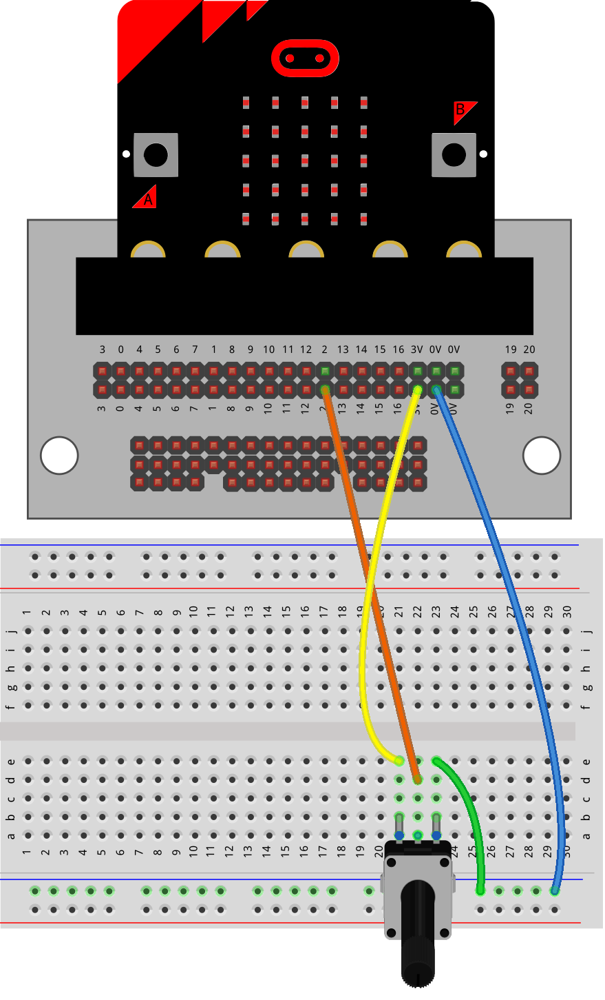
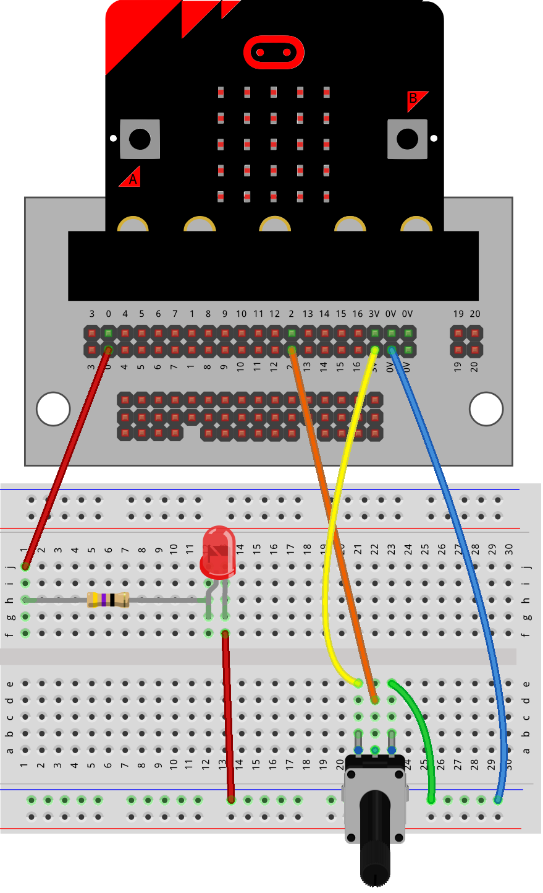
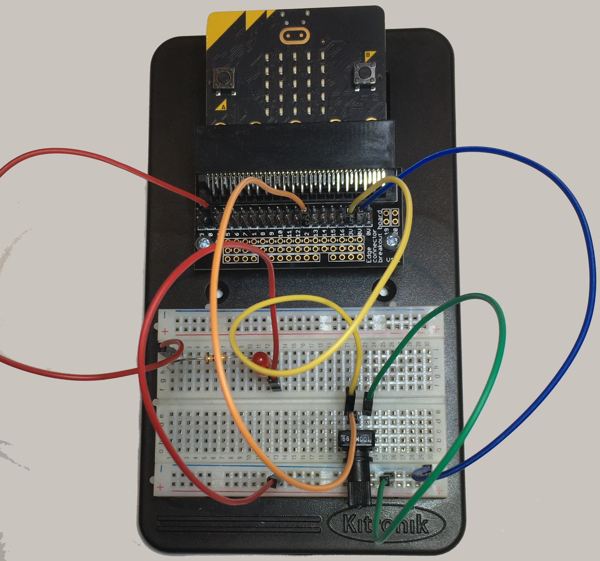
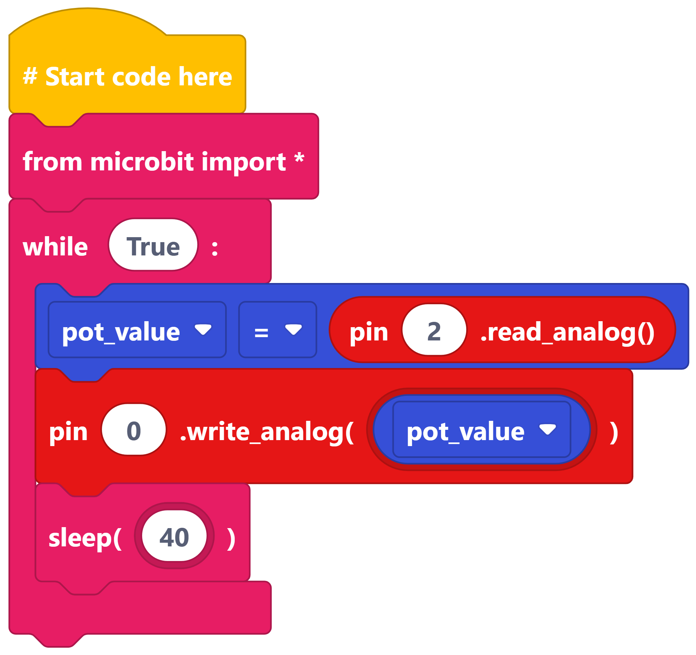
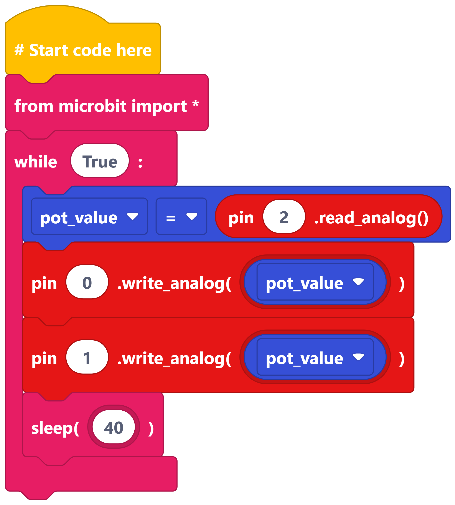
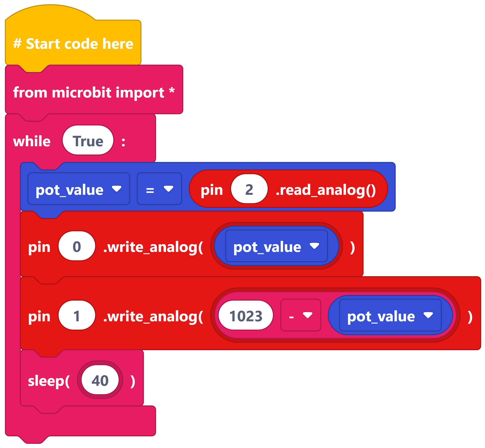
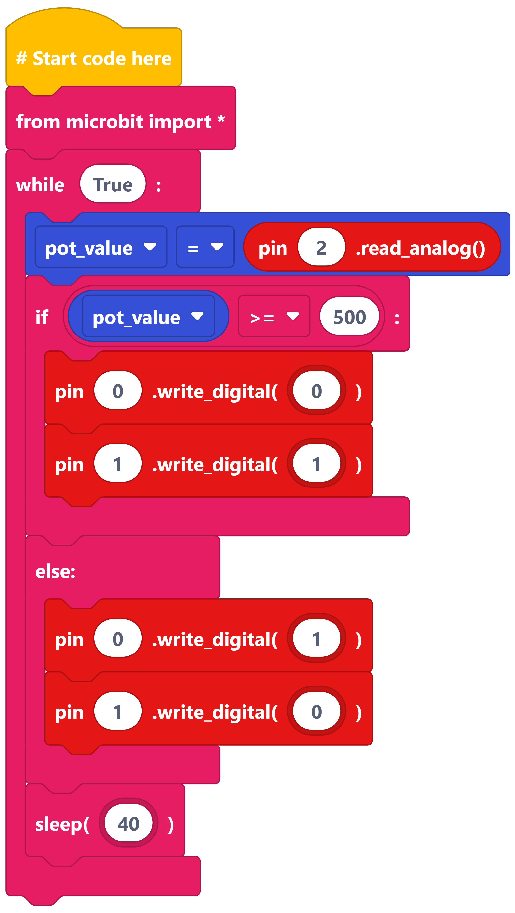

==========================
Potentiometer_with_LED
==========================

Building the circuit
----------------------------------------

----

Controlling LED brightness
----------------------------------------

----

Think about it
----------------------------------------

Can you answer these questions?

* When is the LED brightest?
* When is the LED dimmest?
* What happens when the potentiometer is in the middle?

----

Challenge 1
----------------------------------------

* Add a second LED. Connect it to **pin1**.

----

Challenge 2
----------------------------------------

| Make the LEDs have **opposite brightness**.

| Hint: use ``1023 - pot_val``

----

Challenge 3
----------------------------------------

| If the value is: **500 or more**

    * Yellow LED turns ON.
    * Red LED turns OFF.

| Otherwise:

    * Red LED turns ON.
    * Yellow LED turns OFF.

